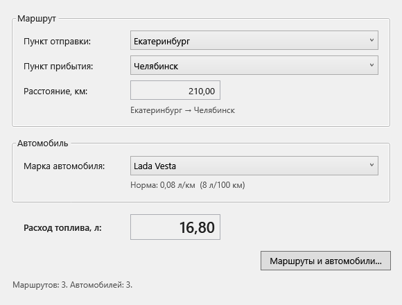
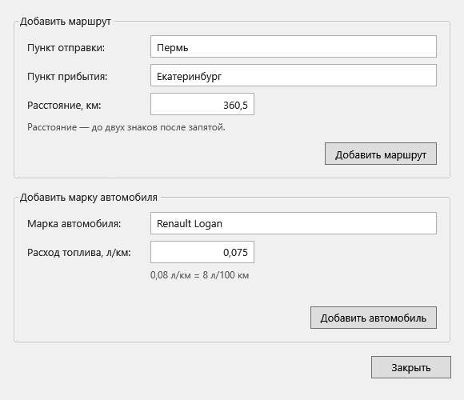

# Расчёт расхода топлива

Задание 1 «C# и БД». Приложение на WPF рассчитывает расход топлива по маршруту и норме выбранного автомобиля. Маршруты и марки автомобилей хранятся в Microsoft SQL Server.

## Формы

На первой форме выбираются отправление, прибытие и автомобиль. Список прибытия доступен после выбора отправления. Расстояние и расход заполняются автоматически; эти поля доступны только для чтения. При смене маршрута или автомобиля расход пересчитывается.



[Начальное состояние первой формы](docs/screenshots/calculator-initial.png).

Вторая форма открывается кнопкой «Маршруты и автомобили…». На ней можно добавить маршрут или марку автомобиля с нормой расхода. После сохранения списки первой формы обновляются.



## Запуск

Понадобятся Windows, .NET 9 SDK и SQL Server. Подойдут установленный SQL Server, SQL Server Express или LocalDB.

Откройте `EASK_Project.sln` в Visual Studio 2022 или Rider и запустите проект. Для Visual Studio нужен компонент «Разработка классических приложений .NET».

Из терминала в корне репозитория:

```powershell
dotnet restore EASK_Project.sln
dotnet run --project EASK_Project
```

По умолчанию приложение подключается к локальному SQL Server (`Server=.`) с учётной записью Windows. При первом запуске оно создаёт базу `EaskFuelTraining`, таблицы и примеры записей. Учётной записи нужны права на создание базы; если база уже есть, нужны права на работу с её таблицами.

## Подключение к базе

Настройки находятся в [appsettings.json](EASK_Project/appsettings.json). Для SQL Server Express укажите `Server=.\SQLEXPRESS`, для LocalDB — `Server=(localdb)\MSSQLLocalDB`. При редактировании JSON обратную косую черту нужно записывать как `\\`.

Строку подключения можно переопределить переменной среды:

```powershell
$env:EASK_CONNECTION_STRING = 'Server=.\SQLEXPRESS;Database=EaskFuelTraining;Integrated Security=True;Encrypt=True;TrustServerCertificate=True;Connect Timeout=10'
dotnet run --project EASK_Project
```

Приложение читает настройки при запуске. После изменения строки подключения его нужно перезапустить. `TrustServerCertificate=True` подходит для локального учебного сервера; для сервера с доверенным сертификатом установите `False`. Если используются логин и пароль SQL Server, задавайте их через переменную среды.

## Расчёт и таблицы

В `Routes` хранятся пункты отправления и прибытия и расстояние в километрах. Пара пунктов уникальна; обратное направление хранится отдельной записью.

В `CarBrands` поле `FuelConsumptionLitersPerKm DECIMAL(9,6)` хранит норму в л/км:

```text
Расход [л] = Расстояние [км] × Норма [л/км]
210 × 0,08 = 16,80 л
```

Норму в л/100 км перед сохранением нужно разделить на 100. Расчёт использует `decimal`; результат отображается с двумя знаками после запятой. Расстояния и нормы в примерах условные.

Пустые названия, одинаковые пункты, дубликаты и неположительные числа отклоняются. Запросы добавления используют параметры `SqlCommand`.

## Код по пунктам задания

| Пункт | Файлы |
| --- | --- |
| 1.1 Две формы | [MainWindow.xaml](EASK_Project/MainWindow.xaml), [DataWindow.xaml](EASK_Project/DataWindow.xaml) |
| 1.2 Чтение и добавление маршрутов | [Queries.sql](Database/Queries.sql) |
| 1.3 Обработчики выбора и расчёт | [MainWindow.xaml.cs](EASK_Project/MainWindow.xaml.cs), [FuelCalculator.cs](EASK_Project/Services/FuelCalculator.cs) |
| Создание таблиц и ограничения | [Schema.sql](Database/Schema.sql) |
| Выполнение запросов на C# | [FuelRepository.cs](EASK_Project/Data/FuelRepository.cs) |
| Добавление через вторую форму | [DataWindow.xaml.cs](EASK_Project/DataWindow.xaml.cs) |

## Проверка

```powershell
dotnet build EASK_Project.sln -c Release
$checkOutput = Join-Path $PWD 'artifacts'
$check = Start-Process -FilePath '.\EASK_Project\bin\Release\net9.0-windows\EASK_Project.exe' -ArgumentList '--verify', ('"{0}"' -f $checkOutput) -PassThru
$check.WaitForExit()
$check.ExitCode
Get-Content .\artifacts\verification.txt
```

Режим `--verify` создаёт отдельную базу `EaskFuelVerification_...` на настроенном сервере. Он проверяет SQL и обработчики форм, сохраняет изображения и удаляет проверочную базу. Для этого нужны права на создание и удаление базы. Тестовые записи не добавляются в рабочую базу приложения.

Проверка включает 31 сценарий: загрузку данных, фильтрацию прибытия, расчёт, сброс значений, добавление через кнопки, обновление списков, числовую валидацию, дубликаты, ограничения SQL и параметризацию. При успехе код завершения равен `0`, при ошибке — `1`. Результаты сохраняются в `artifacts/verification.txt`, ошибка — в `artifacts/verification-error.txt`.

## Сборка для запуска без IDE

```powershell
dotnet publish EASK_Project\EASK_Project.csproj -c Release -o artifacts\application
```

Запускайте `artifacts/application/EASK_Project.exe` вместе с остальными файлами этой папки. На компьютере должны быть .NET 9 Desktop Runtime и настроенный SQL Server.
